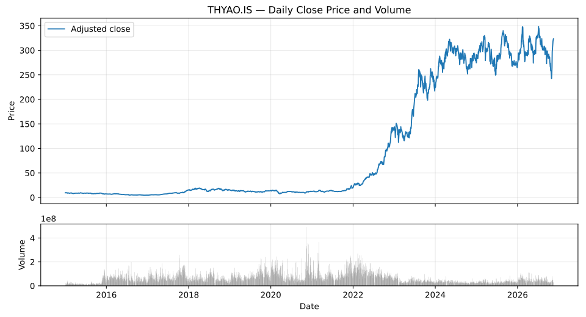
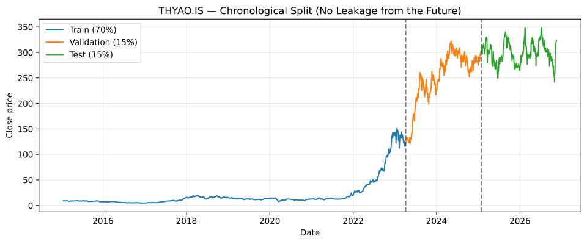
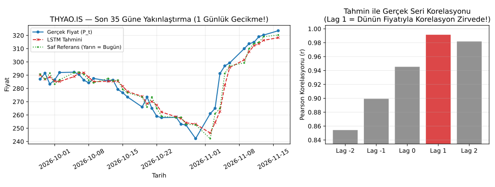
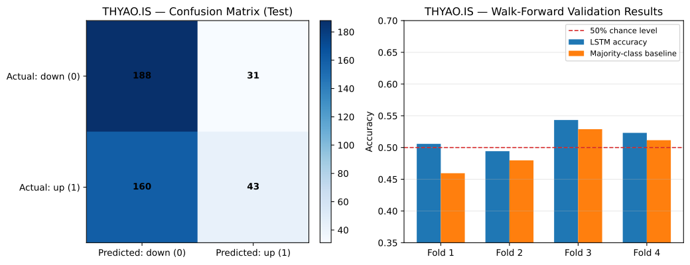

<!-- omarcevi.dev/workshops/pytorch-finance-workshop/ bu dosyadan üretilir. -->

# Finansal Verilerle Yapay Zekâyı Buluşturmak

Finansal zaman serilerinde derin öğrenme modelleri kurmak, ilk bakışta "kusursuz" görünen ama gerçekte yalnızca dünün fiyatını kopyalayan tuzaklarla doludur. Bu 2 saat 15 dakikalık uygulamalı atölyede, Borsa İstanbul (`THYAO.IS`, `ASELS.IS`, `XU100.IS`) ve küresel piyasa (`BTC-USD`, `AAPL`) verileri üzerinde sıfırdan bir PyTorch eğitim döngüsü kuruyor; fiyat tahmini yanılsamasını saf bir referans modelle (*"Yarın = Bugün"*) çürütüyor ve problemi veri sızıntısı olmadan yön sınıflandırması olarak yeniden tanımlıyoruz. Çalışmanın sonunda elinizde gerçekçi metriklerle (**Walk-Forward** doğrulama ve işlem maliyetli backtest) test edilmiş, temiz bir PyTorch zaman serisi şablonu kalacak.

> **Önemli Uyarı (Yatırım Tavsiyesi Değildir):** Bu rehberdeki ve atölye defterlerindeki tüm kodlar, modeller ve analizler yalnızca **makine öğrenmesi ve PyTorch eğitimi** amaçlıdır. Hiçbir içerik yatırım tavsiyesi değildir ve buradaki modeller gerçek alım-satım aracı olarak **kullanılmamalıdır**.

[](images/hook_preview.svg)

*Bölüm 0 Sorumuz: Mavi çizgi gerçek fiyatı, kırmızı kesikli çizgi ise LSTM tahminini gösteriyor. Bu grafikle para kazanabilir miyiz? Cevabı Bölüm 4'te büyüteçle ortaya çıkarıyoruz.*

**Ön Koşullar:**
- Bir dizüstü bilgisayar ve **Google Colab** kullanmak için standart bir Google hesabı (yerel kurulum gerekmez, ücretsiz CPU çalışma zamanı yeterlidir).
- Temel düzeyde Python ve `pandas` bilgisi; daha önce PyTorch eğitim döngüsü yazmış olmanız gerekmez.

**Defter Bağlantıları:**
- **Başlangıç Defteri (Starter — Atölyede birlikte dolduracağımız defter):** [Colab'da Aç](https://colab.research.google.com/github/omarcevi/pytorch-finance-workshop/blob/main/notebooks/workshop_starter.ipynb)
- **Çözüm Defteri (Solution — Tüm kodları ve çıktıları tamamlanmış referans):** [Colab'da Aç](https://colab.research.google.com/github/omarcevi/pytorch-finance-workshop/blob/main/notebooks/workshop_solution.ipynb)

**Atölye Zaman Çizelgesi (18 Kasım 2026 Çarşamba, 16:30–18:45 · DMF-214):**

| Saat | Bölüm | Ne Yapıyoruz / Ne Öğreniyoruz? |
|---|---|---|
| 16:30–16:40 | **Bölüm 0 · Giriş (Hook)** | Bölüm 4'teki "kusursuz" fiyat tahmini grafiğine ilk bakış: *"Bu grafikle para kazanabilir miyiz?"* |
| 16:40–16:55 | **Bölüm 1 · Kurulum ve Veri** | `THYAO.IS` verisini indirme, yedek (snapshot) mekanizması, OHLCV ve düzeltilmiş fiyatların görselleştirilmesi. |
| 16:55–17:15 | **Bölüm 2 · Temizlik ve Özellikler** | Eksik günler (`ffill`), logaritmik getiri, hareketli ortalama, volatilite, RSI, kronolojik bölme (%70/%15/%15) ve sızıntısız `StandardScaler`. |
| 17:15–17:35 | **Bölüm 3 · PyTorch Temelleri** | `Tensor`, 30 günlük `SlidingWindowDataset`, `DataLoader`, `nn.LSTM` mimarisi, her adımda tensör boyutları ve eğitim döngüsü. |
| 17:35–17:45 | **Ara (Mola)** | 10 dakika çay/kahve molası. |
| 17:45–18:05 | **Bölüm 4 · Fiyat Tahmini ve Sürpriz** | Ertesi gün fiyat tahmini, *"Yarın = Bugün"* saf referans modeliyle MAE/RMSE karşılaştırması ve 1 günlük gecikme (lag) analizi. |
| 18:05–18:25 | **Bölüm 5 · Doğru Kurulum** | Getiri tabanlı özelliklerle ertesi gün yön sınıflandırması (`BCEWithLogitsLoss`), çoğunluk sınıfı referansı ve 4 katlı Walk-Forward doğrulama. |
| 18:25–18:40 | **Bölüm 6 · Meydan Okumalar** | Kendi sembolünü deneme, hacim özelliği ekleme, `GRU` ve `TinyTransformer` modelleri, işlem maliyetli (15 bps) backtest. |
| 18:40–18:45 | **Bölüm 7 · Kapanış** | Eve götürülecek 3 temel ders, gerçek quant ekiplerinin farkı ve kaynaklar. |

## Bölüm 1 · Kurulum ve Veri

**Hedef:** Çalışma ortamını hazırlamak, `THYAO.IS` günlük fiyat verisini hız sınırına (rate limit) takılmadan indirmek ve OHLCV yapısını görselleştirmek.

**Temel Fikirler:**
- **OHLCV Nedir?** Borsa verisinde her işlem günü beş sayıyla temsil edilir: **O**pen (Açılış), **H**igh (En Yüksek), **L**ow (En Düşük), **C**lose (Kapanış) ve **V**olume (İşlem Hacmi).
- **Düzeltilmiş Fiyatlar (`auto_adjust=True`):** Şirketler temettü dağıttığında veya hisse bölünmesi yaptığında ham fiyatta yapay düşüşler oluşur. `yfinance` içinde `auto_adjust=True` kullanarak tüm geçmiş OHLC fiyatlarını bölünme ve temettülere göre düzeltilmiş olarak alırız.
- **Kesintisiz Yedek Veri (Fallback):** Salondaki 40 kişi aynı anda Yahoo Finance sunucularına bağlandığında hız sınırına (`YFRateLimitError`) takılmak olasıdır. `load_prices` fonksiyonu hata veya boş tablo durumunda otomatik olarak yedek (snapshot) veriyi yükler.

**Yetiştir Hücresi:** `🔄 Yetiştir: Bölüm 1 (Çalışma zamanı sıfırlandıysa çalıştırın)`

**Adım Adım Kod Açıklaması:**

İlk kurulum hücresini çalıştırdıktan sonra **TODO 1** (`sec1-load-code`) hücresinde `load_prices` fonksiyonunu çağırarak `THYAO.IS` verisini yüklüyoruz:

```python
TICKER = "THYAO.IS"

# TODO 1 çözümü:
raw_df = load_prices(TICKER, start="2015-01-01", end="2026-11-17")

print(f"Veri boyutu: {raw_df.shape} | Tarih aralığı: {raw_df.index.min().date()} -> {raw_df.index.max().date()}")
display(raw_df.tail(5))
```

Ardından kapanış fiyatını ve işlem hacmini `plot_ohlcv` ile alt alta çizdiriyoruz:

```python
fig = plot_ohlcv(raw_df, ticker=TICKER)
plt.show()
```

[](images/ohlcv.svg)

*Beklenen Çıktı: `(3023, 5)` boyutunda tablo (`2015-01-01 -> 2026-11-16`) ve 2015'teki ~5 TL seviyesinden 2026'da 300+ TL seviyesine yükselen kapanış grafiği.*

**Sorun Giderme (Bu Adım Çalışmazsa):**
- **Yahoo Finance Hız Sınırı (`YFRateLimitError` veya boş tablo):** Hiçbir şey yapmanıza gerek yoktur; `load_prices` ekrana `⚠️ Yahoo Finance'ten veri alınamadı... Yedek veri (snapshot) yükleniyor...` mesajını yazdırır ve yerel/bulut yedek veriyi yükler.
- **`NameError: name 'load_prices' is not defined`:** Colab çalışma zamanınız yeniden başlamış olabilir. Bölüm 1'in başındaki **`🔄 Yetiştir: Bölüm 1`** hücresini çalıştırın.

## Bölüm 2 · Temizlik ve Özellikler

**Hedef:** Ham fiyatları durağan (stationary) getiri özelliklerine dönüştürmek, veriyi zaman sırasını bozmadan (%70/%15/%15) bölmek ve `StandardScaler` nesnesini veri sızıntısı olmadan yalnızca eğitim kümesinde fit etmek.

**Temel Fikirler:**
- **Eksik Günler ve Kapalı Piyasalar:** Hafta sonları ve resmi tatillerde borsa kapalıdır. Eksik değerleri doldururken yalnızca geçmişteki son bilinen fiyatı ileri taşırız (`ffill`). Gelecekteki fiyatı geriye taşımak (`bfill`) geleceği kopyalamaktır.
- **Neden Fiyat Yerine Logaritmik Getiri?** 2015'teki 6 TL ile 2026'daki 300 TL aynı ölçekte değildir. Logaritmik getiri $r_t = \ln(P_t / P_{t-1})$ seriyi ölçekten bağımsız ve durağan hale getirir.
- **Kronolojik Bölme ve Scaler Sızıntısı:** Zaman serisi asla rastgele (`shuffle=True`) bölünmez. Ayrıca `StandardScaler.fit()` işlemi tüm veriye uygulanırsa 2026 yılının ortalama ve standart sapması 2018'deki eğitim verisine sızar.

**Yetiştir Hücresi:** `🔄 Yetiştir: Bölüm 2 (Önceki bölümü atladıysanız çalıştırın)`

**Adım Adım Kod Açıklaması:**

1. **TODO 2 (`sec2-feat-code`):** Günlük logaritmik getiriyi (`log_return`), 5 günlük hareketli ortalamayı (`roll_mean_5`) ve 10 günlük oynaklığı/volatiliteyi (`roll_std_10`) hesaplıyoruz:

```python
feat_df = raw_df[["Open", "High", "Low", "Close", "Volume"]].ffill().dropna().copy()

# TODO 2 çözümü:
feat_df["log_return"] = np.log(feat_df["Close"] / feat_df["Close"].shift(1))
feat_df["roll_mean_5"] = feat_df["log_return"].rolling(window=5).mean()
feat_df["roll_std_10"] = feat_df["log_return"].rolling(window=10).std()

feat_df["rsi_14"] = compute_rsi(feat_df["Close"], period=14) / 100.0
feat_df["up_day"] = (feat_df["log_return"] > 0.0).astype(np.float32)
feat_df = feat_df.dropna().copy()
```

2. **TODO 3 (`sec2-split-code`):** Özellik tablosunu zaman sırasıyla %70 Eğitim, %15 Doğrulama ve %15 Test olarak üçe bölüyoruz:

```python
# TODO 3 çözümü:
train_df, val_df, test_df = chronological_split(feat_df, train_ratio=0.70, val_ratio=0.15)
```

[](images/chronological_split.svg)

*Beklenen Çıktı: `Train: 2106 gün (2015-01-21 -> 2023-02-23)`, `Val: 451 gün (2023-02-24 -> 2024-11-26)`, `Test: 452 gün (2024-11-27 -> 2026-11-16)`.*

3. **TODO 4 (`sec2-scaler-code`):** Ölçekleyiciyi (`StandardScaler`) **yalnızca `train_df`** üzerinde `fit_transform` ediyor, `val_df` ve `test_df` üzerinde ise yalnızca `transform` çağırıyoruz:

```python
from sklearn.preprocessing import StandardScaler

scaler = StandardScaler()

# TODO 4 çözümü:
x_train = scaler.fit_transform(train_df[FEATURE_COLS].values.astype(np.float32))
x_val = scaler.transform(val_df[FEATURE_COLS].values.astype(np.float32))
x_test = scaler.transform(test_df[FEATURE_COLS].values.astype(np.float32))
```

**Sorun Giderme (Bu Adım Çalışmazsa):**
- **`KeyError: 'log_return'`:** `sec2-feat-code` hücresini çalıştırmadan bölme hücresine geçmiş olabilirsiniz; sırayla çalıştırın veya bölüm başındaki **`🔄 Yetiştir: Bölüm 2`** hücresini kullanın.
- **`ValueError: Found array with 0 sample(s)`:** `dropna()` öncesi pencere hesaplamalarında yanlış sütun adı yazılmış olabilir; yukarıdaki 3 satırı kontrol edin.

## Bölüm 3 · PyTorch Temelleri

**Hedef:** 30 günlük kayan pencere (`SlidingWindowDataset`) yapısını kurmak, `nn.LSTM` modelinde tensör boyutlarını (`batch, seq_len, features`) adım adım izlemek ve 5 adımlı PyTorch eğitim döngüsünü yazmak.

**Temel Fikirler:**
- **3 Boyutlu LSTM Girdisi:** `nn.LSTM(..., batch_first=True)` katmanı girdiyi `(batch_size, seq_len, features)` boyutunda bekler. Bizim kurulumumuzda bir batch `(64, 30, 4)` boyutundadır (64 örnek, 30 iş günü, 4 özellik).
- **Eğitim İçinde Pencereleri Karıştırmak (`shuffle=True`):** Eğitim, doğrulama ve test kümelerimiz birbirinden kesin olarak zamanla ayrılmıştır. Ancak eğitim kümesinin *kendi içindeki* 30 günlük hazır pencereleri `DataLoader(..., shuffle=True)` ile karıştırmak veri sızıntısı yaratmaz; çünkü her pencere kendi içindeki 30 günlük zaman sırasını zaten korur.

**Yetiştir Hücresi:** `🔄 Yetiştir: Bölüm 3 (Önceki bölümü atladıysanız çalıştırın)`

**Adım Adım Kod Açıklaması:**

1. **TODO 5 (`sec3-dataset-code`):** `SlidingWindowDataset` ve `DataLoader` nesnelerini oluşturuyoruz:

```python
WINDOW_SIZE = 30
BATCH_SIZE = 64

y_train_ret = train_df["log_return"].values.astype(np.float32)
y_val_ret = val_df["log_return"].values.astype(np.float32)

# TODO 5 çözümü:
train_ds = SlidingWindowDataset(x_train, y_train_ret, window_size=WINDOW_SIZE)
val_ds = SlidingWindowDataset(x_val, y_val_ret, window_size=WINDOW_SIZE)
train_loader = DataLoader(train_ds, batch_size=BATCH_SIZE, shuffle=True)
val_loader = DataLoader(val_ds, batch_size=BATCH_SIZE, shuffle=False)
```

2. **TODO 6 (`sec3-model-code`):** `SimpleLSTM` sınıfının `forward` metodunda girdiyi LSTM'den geçirip yalnızca son zaman adımının gizli durumunu (`out[:, -1, :]`) doğrusal katmana (`self.fc`) veriyoruz:

```python
class SimpleLSTM(nn.Module):
    def __init__(self, input_dim: int, hidden_dim: int = 32) -> None:
        super().__init__()
        self.lstm = nn.LSTM(input_dim, hidden_dim, batch_first=True)
        self.fc = nn.Linear(hidden_dim, 1)

    def forward(self, x: torch.Tensor) -> torch.Tensor:
        # TODO 6 çözümü:
        out, _ = self.lstm(x)
        last_step = out[:, -1, :]
        return self.fc(last_step).squeeze(-1)
```

3. **TODO 7 (`sec3-train-code`):** Klasik 5 adımlı PyTorch eğitim döngüsünü (`zero_grad -> forward -> loss -> backward -> step`) tamamlıyoruz:

```python
    for bx, by in train_loader:
        # TODO 7 çözümü:
        optimizer.zero_grad()
        pred = demo_model(bx)
        loss = criterion(pred, by)
        loss.backward()
        optimizer.step()
        batch_losses.append(loss.item())
```

**Beklenen Çıktı (Tensör Boyutları ve Eğitim):**
```text
1) Giriş tensörü (bx)          : torch.Size([64, 30, 4])
2) LSTM tüm adımlar (lstm_out) : torch.Size([64, 30, 32])
3) Son zaman adımı ([:, -1, :]): torch.Size([64, 32])
4) Model çıktısı (pred_out)    : torch.Size([64])
Son Epoch (10) -> Train MSE: 0.000733 | Val MSE: 0.000668
```

**Sorun Giderme (Bu Adım Çalışmazsa):**
- **Boyut Hatası (`RuntimeError: input.size(-1) must be equal to input_size`):** `SimpleLSTM(input_dim=...)` parametresinin `len(FEATURE_COLS)` (yani `4`) olduğundan ve `nn.LSTM` içinde `batch_first=True` verildiğinden emin olun.
- **`squeeze(-1)` unutulursa:** Model çıktısı `(64, 1)` olurken hedef `by` `(64,)` boyutundadır; `MSELoss` yayınlama (broadcasting) uyarısı verir. `return self.fc(last_step).squeeze(-1)` ile iki boyutu eşitleyin.

## Bölüm 4 · Fiyat Tahmini ve Sürpriz

**Hedef:** Ertesi günün kapanış fiyatını tahmin eden bir LSTM eğitmek, uzaktan "kusursuz" görünen grafiğin aslında *"Yarın = Bugün"* saf referans modelinden (naive baseline) daha yüksek hataya sahip olduğunu ölçmek ve 1 günlük gecikmeyi (lag) görselleştirmek.

**Temel Fikirler:**
- **İkinci Tuzak (Global Scaler ve Aktivasyon Doyması):** `THYAO.IS` fiyatı eğitim döneminde 4.5 TL – 151 TL aralığındayken test döneminde 242 TL – 348 TL aralığındadır. Tüm eğitim setine tek bir `StandardScaler` uygularsanız test girdileri $z > 6$ değerine çıkar ve LSTM'in `tanh`/`sigmoid` kapıları doyuma (saturation) ulaşarak düz bir çizgiye kilitlenir. Hikâyeyi bulandırmamak için `PriceWindowDataset` her 30 günlük pencereyi kendi ilk gününe göre (`fiyat / ilk_gün - 1`) bağıl olarak ölçekler.
- **Saf Referans Modeli (Naive Baseline):** Hiç yapay zekâ kullanmadan *"Yarının fiyatı bugünün kapanış fiyatına eşittir"* ($\hat{P}_{t+1} = P_t$) diyen en basit kuraldır.
- **1 Günlük Gecikme Yanılsaması:** Günlük hisse fiyatları rastgele yürüyüşe ($P_{t+1} = P_t + \epsilon$) çok yakındır. Karesel hatayı (MSE) minimize etmek isteyen LSTM, geleceği tahmin etmek yerine son gördüğü fiyatı ($P_t$) kopyalamayı öğrenir.

**Yetiştir Hücresi:** `🔄 Yetiştir: Bölüm 4 (Moladan sonra temiz başlangıç için çalıştırın)`

**Adım Adım Kod Açıklaması:**

1. `sec4-train-code` hücresini çalıştırarak fiyat modelini 15 epoch eğitiyor ve uzaktan "kusursuz" görünen test grafiğini çizdiriyoruz.
2. **TODO 8 (`sec4-naive-code`):** Gerçek fiyatlarla (`actual_prices`) hem LSTM tahmininin (`predicted_prices`) hem de saf referans modelinin (`naive_prices`) MAE ve RMSE hatalarını TL cinsinden hesaplıyoruz:

```python
# TODO 8 çözümü:
lstm_mae = float(np.mean(np.abs(actual_prices - predicted_prices)))
naive_mae = float(np.mean(np.abs(actual_prices - naive_prices)))
lstm_rmse = float(np.sqrt(np.mean((actual_prices - predicted_prices) ** 2)))
naive_rmse = float(np.sqrt(np.mean((actual_prices - naive_prices) ** 2)))
```

3. `sec4-zoom-code` hücresini çalıştırarak son 35 iş gününe yakınlaşıyor ve gecikme (lag) korelasyonlarını çizdiriyoruz:

[](images/zoom_and_lag.svg)

**Beklenen Çıktı (Ölçülen Gerçek Değerler):**
```text
📊 LSTM Fiyat Modeli   -> MAE: 5.07 TL | RMSE: 6.46 TL
📏 Saf Referans (P_t)  -> MAE: 4.55 TL | RMSE: 5.99 TL
👉 Sonuç: Saf 'Yarın = Bugün' tahmini, LSTM'den 0.51 TL daha düşük hataya sahip!
Tahminin BUGÜNÜN gerçek fiyatıyla korelasyonu (Lag 0): 0.9461
Tahminin DÜNÜN gerçek fiyatıyla korelasyonu   (Lag 1): 0.9912
```

*Gördüğünüz gibi: LSTM tahmininin bugünün gerçek fiyatıyla korelasyonu `0.9461` iken, **dünün gerçek fiyatıyla (`Lag 1`) korelasyonu `0.9912`** düzeyindedir! Kırmızı çizgi, mavi çizginin 1 gün sağa kaydırılmış kopyasıdır.*

**Sorun Giderme (Bu Adım Çalışmazsa):**
- **Moladan sonra Colab bağlantısı koptuysa:** Doğrudan bölüm başındaki **`🔄 Yetiştir: Bölüm 4`** hücresini çalıştırıp `sec4-train-code` ile devam edin.

## Bölüm 5 · Doğru Kurulum

**Hedef:** Problemi durağan getiri özellikleri üzerinde **ertesi günün yönü** (Yükseliş = `1`, Düşüş = `0`) ikili sınıflandırması olarak yeniden kurmak, `BCEWithLogitsLoss` ile eğitmek, çoğunluk sınıfı referansıyla karşılaştırmak ve 4 katlı **Walk-Forward** doğrulama yapmak.

**Temel Fikirler:**
- **`BCEWithLogitsLoss`:** İkili sınıflandırmada modelin son katmanından çıkan ham skoru (`logit`) alır, içeride sayısal olarak kararlı biçimde `sigmoid` uygular ve çapraz entropi kaybını hesaplar.
- **Çoğunluk Sınıfı Referansı (Majority-Class Baseline):** Eğitim setinde yükseliş günleri %52 ise, test setindeki her güne "Yükseliş" diyen saf model %52 civarında doğruluk alır. Modelimizi hem doğruluk (`Accuracy`) hem de sınıf dengesizliğine duyarlı **Dengeli Doğruluk (`Balanced Accuracy`)** ile ölçeriz.
- **Neden Dürüst Sonuç ~%50–%55 Bandındadır?** Etkin piyasalar, yüksek günlük gürültü ve değişen makroekonomik rejimler nedeniyle yalnızca geçmiş fiyatlardan yön tahmini yapmak yazı-turaya çok yakındır.

**Yetiştir Hücresi:** `🔄 Yetiştir: Bölüm 5 (Önceki bölümü atladıysanız çalıştırın)`

**Adım Adım Kod Açıklaması:**

**TODO 9 (`sec5-cls-code`):** `train_direction_classifier` yardımcı fonksiyonunu çağırarak yön sınıflandırma modelini eğitiyoruz:

```python
y_train_dir = train_df["up_day"].values.astype(np.float32)
y_val_dir = val_df["up_day"].values.astype(np.float32)
y_test_dir = test_df["up_day"].values.astype(np.float32)

# TODO 9 çözümü:
cls_res = train_direction_classifier(
    x_train,
    y_train_dir,
    x_val,
    y_val_dir,
    x_test,
    y_test_dir,
    window_size=WINDOW_SIZE,
    epochs=15,
    seed=42,
)
```

Ardından `sec5-wf-code` hücresini çalıştırarak 4 katlı Walk-Forward doğrulamayı ve karmaşıklık matrisini çizdiriyoruz:

[](images/direction_results.svg)

**Beklenen Çıktı (Ölçülen Gerçek Değerler):**
```text
🎯 LSTM Test Doğruluğu (Accuracy)         : %54.74
⚖️ LSTM Dengeli Doğruluk (Balanced Acc)   : %53.50
📏 Çoğunluk Sınıfı Referansı (Baseline)   : %51.90
Walk-Forward Ortalama Doğruluk            : %51.50
```

**Sorun Giderme (Bu Adım Çalışmazsa):**
- **`ValueError: Target size ... must be the same as input size`:** Hedef vektörü olarak `train_df["up_day"].values.astype(np.float32)` kullandığınızdan emin olun. Değişkenler eksikse **`🔄 Yetiştir: Bölüm 5`** hücresini çalıştırın.

## Bölüm 6 · Meydan Okumalar

**Hedef:** Kurduğumuz sızıntısız değerlendirme hattı üzerinde farklı sembolleri, yeni özellikleri (`volume_change`), alternatif mimarileri (`GRU`, `TinyTransformer`) ve işlem maliyetli (`15 bps`) strateji testini denemek.

**Yetiştir Hücresi:** `🔄 Yetiştir: Bölüm 6 (Meydan okumalar için tüm değişkenleri hazırlar)`

**Meydan Okumalar ve Çözüm İpuçları:**

1. **Meydan Okuma 1 — Kendi Sembolünü Dene:** `load_prices("ASELS.IS")`, `load_prices("BTC-USD")` veya `load_prices("AAPL")` ile veriyi indirin. Geçersiz bir sembol (`load_prices("GECERSIZ_XYZ")`) verdiğinizde Türkçe `ValueError` mesajının nasıl yakalandığını görün.
2. **Meydan Okuma 2 — İşlem Hacmi (`volume_change`) Özelliğini Ekle:** `cols_5 = FEATURE_COLS + ["volume_change"]` listesini `fit_scaler_on_train` fonksiyonuna vererek 5 özellikle modeli yeniden eğitin (`THYAO.IS` üzerinde test doğruluğu `%52.84` civarında çıkar).
3. **Meydan Okuma 3 — `nn.LSTM` Yerine `nn.GRU` ve 15 Günlük Pencere:** `train_direction_classifier(..., window_size=15, model_cls=GRUModel)` çağrısıyla daha az parametreli `GRU` modelini deneyin (`Test Acc: %50.35`).
4. **Meydan Okuma 4 (Bonus) — `TinyTransformerModel` ve İşlem Maliyetli Backtest:** `backtest_with_costs(test_rets, cls_res["y_pred"], cost_bps=15.0)` çağrısıyla her alım-satımda ödenen %0.15 komisyon+makas maliyetinin brüt strateji getirisini (`1.31x`) net `0.86x` seviyesine nasıl düşürdüğünü grafikte gözlemleyin!

**Sorun Giderme (Bu Adım Çalışmazsa):**
- **Kendi seçtiğiniz bir BIST sembolünde `yeterli geçmiş veri yok` hatası:** Yeni halka arz olmuş hisselerde 120 günden az veri bulunabilir; daha eski bir sembol seçin veya `min_rows` parametresini küçültün.
- **Çözüm kodlarını görmek için:** Defterde her meydan okumanın altındaki **`💡 Çözüm`** hücresine çift tıklayarak kodu açabilir veya doğrudan çalıştırabilirsiniz.

## İleri Okuma ve Kaynaklar

Atölyede öğrendiğimiz kavramları derinleştirmek için doğrulanmış temel kaynaklar:

1. **PyTorch Resmi Dokümantasyonu ve Eğitimleri:**
   - [PyTorch Tutorials — Learn the Basics](https://pytorch.org/tutorials/beginner/basics/intro.html): `Tensor`, `Dataset`, `DataLoader`, `nn.Module` ve eğitim döngüsü temelleri.
   - [PyTorch `nn.LSTM` Resmi Referansı](https://pytorch.org/docs/stable/generated/torch.nn.LSTM.html): Giriş/çıkış tensör boyutları (`batch_first=True`) ve kapı denklemleri.
   - [PyTorch `nn.BCEWithLogitsLoss` Referansı](https://pytorch.org/docs/stable/generated/torch.nn.BCEWithLogitsLoss.html): İkili sınıflandırmada sayısal kararlılık ve `sigmoid` birleşimi.
2. **Zaman Serisi Doğrulaması (Walk-Forward) ve Veri Sızıntısı (Data Leakage):**
   - [Scikit-Learn — TimeSeriesSplit](https://scikit-learn.org/stable/modules/cross_validation.html#time-series-split): Zaman serilerinde neden standart k-fold çapraz doğrulama kullanılamayacağının ve genişleyen pencere (walk-forward) doğrulamanın resmi açıklaması.
   - [Scikit-Learn — Common Pitfalls and Recommended Practices (Data Leakage)](https://scikit-learn.org/stable/common_pitfalls.html): Ön-işleme (`StandardScaler`) adımlarında eğitim ve test verisi arasındaki sızıntıyı önleme rehberi.
   - [Hyndman & Athanasopoulos — Forecasting: Principles and Practice (Evaluating Forecast Accuracy)](https://otexts.com/fpp3/accuracy.html): Saf referans modelleri (Naive forecast / random walk baseline) ve zaman serisi hata metrikleri üzerine standart akademik kaynak.

> **Son Hatırlatma:** Bu atölye ve rehber yalnızca eğitim amaçlıdır; yatırım tavsiyesi niteliği taşımaz.
