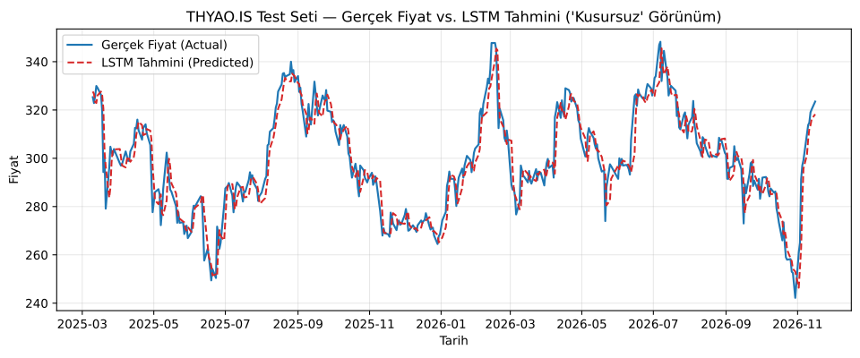

<!-- omarcevi.dev/workshops/pytorch-finance-workshop/ is generated from this file. -->

# Bringing AI to Financial Data

Deep learning on financial time series is full of traps: models that look "perfect" at first glance but are really just copying yesterday's price. In this 2 hour 15 minute hands-on workshop we build a PyTorch training loop from scratch on Borsa Istanbul (`THYAO.IS`, `ASELS.IS`, `XU100.IS`) and global market (`BTC-USD`, `AAPL`) data. We debunk the price-prediction illusion with a naive baseline (*"tomorrow = today"*), then reframe the problem, without data leakage, as direction classification. You leave with a clean PyTorch time-series template tested with honest metrics (**walk-forward** validation and a backtest with trading costs).

> **Important (Not Investment Advice):** All code, models and analysis in this guide and the workshop notebooks are for **machine learning and PyTorch education** only. Nothing here is investment advice, and these models **must not** be used as real trading tools.

[](images/hook_preview.svg)

*Our Part 0 question: the blue line is the actual price, the red dashed line is the LSTM's prediction. Could we make money with this chart? We put it under the magnifying glass in Part 4.*

**Prerequisites:**
- A laptop and a regular Google account for **Google Colab** (nothing to install locally; the free CPU runtime is enough).
- Basic Python and `pandas`; you do not need to have written a PyTorch training loop before.

**Notebooks:**
- **Starter notebook (the one we fill in together during the workshop):** [Open in Colab](https://colab.research.google.com/github/omarcevi/pytorch-finance-workshop/blob/main/notebooks/workshop_starter.ipynb)
- **Solution notebook (reference with all code and outputs filled in):** [Open in Colab](https://colab.research.google.com/github/omarcevi/pytorch-finance-workshop/blob/main/notebooks/workshop_solution.ipynb)

**How the notebooks help you:** each ✏️ TODO cell ends with a ✅ check that tells you whether your code is right, and what to fix if not. In the starter notebook a collapsed 💡 Hint and 👀 Solution sit under every TODO, and the 🔄 Catch up cell at the start of each part rebuilds everything up to that point.

**Schedule (Wednesday 18 November 2026, 16:30–18:45 · DMF-214):**

| Time | Part | What we do and learn |
|---|---|---|
| 16:30–16:40 | **Part 0 · Intro (Hook)** | A first look at the "perfect" price prediction from Part 4: *"Could we make money with this chart?"* |
| 16:40–16:55 | **Part 1 · Setup and Data** | Downloading `THYAO.IS`, the snapshot fallback, OHLCV and adjusted prices on a chart. |
| 16:55–17:15 | **Part 2 · Cleaning and Features** | Missing values (`ffill`), log returns, moving average, volatility, RSI, a chronological 70/15/15 split and a leak-free `StandardScaler`. |
| 17:15–17:35 | **Part 3 · PyTorch Basics** | `Tensor`, a 30-day `SlidingWindowDataset`, `DataLoader`, the `nn.LSTM` architecture, tensor shapes at every step and the training loop. |
| 17:35–17:45 | **Break** | 10-minute tea and coffee break. |
| 17:45–18:05 | **Part 4 · Price Prediction and the Surprise** | Next-day price prediction, MAE/RMSE against the *"tomorrow = today"* naive baseline, and the one-day lag analysis. |
| 18:05–18:25 | **Part 5 · The Right Setup** | Next-day direction classification on return features (`BCEWithLogitsLoss`), a majority-class baseline and 4-fold walk-forward validation. |
| 18:25–18:40 | **Part 6 · Challenges** | Your own ticker, a volume feature, `GRU` and `TinyTransformer` models, a backtest with trading costs (15 bps). |
| 18:40–18:45 | **Part 7 · Wrap-up** | Three takeaways, what real quant teams do differently, and resources. |

## Part 1 · Setup and Data

**Goal:** Set up the environment, download daily `THYAO.IS` prices without getting stuck on rate limits, and visualise the OHLCV structure.

**Key ideas:**
- **What is OHLCV?** Each trading day is summarised by five numbers: **O**pen, **H**igh, **L**ow, **C**lose and **V**olume.
- **Adjusted prices (`auto_adjust=True`):** Dividends and stock splits create artificial drops in the raw price. With `auto_adjust=True`, `yfinance` returns all historical OHLC prices adjusted for splits and dividends.
- **A fallback that always works:** When 40 people in one room hit Yahoo Finance at once, a rate limit (`YFRateLimitError`) is likely. On an error or an empty table, `load_prices` automatically loads snapshot data instead.

**Catch-up cell:** `🔄 Catch up: Part 1 (run this if your runtime was reset)`

**Step-by-step code walkthrough:**

After running the ⚙️ Setup cell, we load `THYAO.IS` by calling `load_prices` in **TODO 1** (`sec1-load-code`):

```python
TICKER = "THYAO.IS"

# TODO 1 solution:
raw_df = load_prices(TICKER, start="2015-01-01", end="2026-11-17")

print(f"Data shape: {raw_df.shape} | Date range: {raw_df.index.min().date()} -> {raw_df.index.max().date()}")
display(raw_df.tail(5))
```

Then we plot the close price and the volume one above the other with `plot_ohlcv`:

```python
fig = plot_ohlcv(raw_df, ticker=TICKER)
plt.show()
```

[](images/ohlcv.svg)

*Expected output: a table of shape `(3023, 5)` (`2015-01-01 -> 2026-11-16`) and a close-price chart that climbs from single-digit lira in 2015–2016 to over 300 TL in 2026.*

**Troubleshooting (if this step fails):**
- **Yahoo Finance rate limit (`YFRateLimitError` or an empty table):** Nothing to do. `load_prices` prints `⚠️ Could not get THYAO.IS from Yahoo Finance (...). Loading the snapshot data...` and loads the local or online snapshot.
- **`NameError: name 'load_prices' is not defined`:** Your Colab runtime has probably restarted. Run the **`🔄 Catch up: Part 1`** cell at the top of Part 1.

## Part 2 · Cleaning and Features

**Goal:** Turn raw prices into stationary return features, split the data without breaking time order (70/15/15), and fit `StandardScaler` on the training set only, so nothing leaks.

**Key ideas:**
- **Missing values and closed markets:** Exchanges are closed at weekends and on public holidays. When filling missing values we only carry the last known past value forward (`ffill`). Carrying a future value backwards (`bfill`) is copying the future.
- **Why log returns instead of prices?** 6 TL in 2015 and 300 TL in 2026 are not on the same scale. The log return $r_t = \ln(P_t / P_{t-1})$ makes the series scale-free and stationary.
- **Chronological split and scaler leakage:** A time series is never split at random (`shuffle=True`). And if `StandardScaler.fit()` sees all the data, the mean and standard deviation of 2026 leak into the 2018 training data.

**Catch-up cell:** `🔄 Catch up: Part 2 (run this if you skipped the previous part)`

**Step-by-step code walkthrough:**

1. **TODO 2 (`sec2-feat-code`):** We compute the daily log return (`log_return`), the 5-day moving average of returns (`roll_mean_5`) and the 10-day volatility (`roll_std_10`):

```python
feat_df = raw_df[["Open", "High", "Low", "Close", "Volume"]].ffill().dropna().copy()

# TODO 2 solution:
feat_df["log_return"] = np.log(feat_df["Close"] / feat_df["Close"].shift(1))
feat_df["roll_mean_5"] = feat_df["log_return"].rolling(window=5).mean()
feat_df["roll_std_10"] = feat_df["log_return"].rolling(window=10).std()

feat_df["rsi_14"] = compute_rsi(feat_df["Close"], period=14) / 100.0
feat_df["up_day"] = (feat_df["log_return"] > 0.0).astype(np.float32)
feat_df = feat_df.dropna().copy()
```

2. **TODO 3 (`sec2-split-code`):** We split the feature table in time order into 70% train, 15% validation and 15% test:

```python
# TODO 3 solution:
train_df, val_df, test_df = chronological_split(feat_df, train_ratio=0.70, val_ratio=0.15)
```

[](images/chronological_split.svg)

*Expected output: `Train: 2106 days (2015-01-21 -> 2023-04-05)`, `Val  : 451 days (2023-04-06 -> 2025-01-24)`, `Test : 452 days (2025-01-27 -> 2026-11-16)` (trading days).*

3. **TODO 4 (`sec2-scaler-code`):** We call `fit_transform` on **`train_df` only**, and only `transform` on `val_df` and `test_df`:

```python
from sklearn.preprocessing import StandardScaler

scaler = StandardScaler()

# TODO 4 solution:
x_train = scaler.fit_transform(train_df[FEATURE_COLS].values.astype(np.float32))
x_val = scaler.transform(val_df[FEATURE_COLS].values.astype(np.float32))
x_test = scaler.transform(test_df[FEATURE_COLS].values.astype(np.float32))
```

**Troubleshooting (if this step fails):**
- **`KeyError: 'log_return'`:** You probably jumped to the split cell before running `sec2-feat-code`. Run the cells in order, or use the **`🔄 Catch up: Part 2`** cell at the top of the part.
- **`ValueError: Found array with 0 sample(s)`:** A column name in the rolling-window code is probably misspelled before `dropna()`. Check the three lines above.

## Part 3 · PyTorch Basics

**Goal:** Build the 30-day sliding window (`SlidingWindowDataset`), follow the tensor shapes (`batch, seq_len, features`) through `nn.LSTM` step by step, and write the five-step PyTorch training loop.

**Key ideas:**
- **3-D LSTM input:** `nn.LSTM(..., batch_first=True)` expects input of shape `(batch_size, seq_len, features)`. In our setup one batch is `(64, 30, 4)`: 64 samples, 30 trading days, 4 features.
- **Shuffling windows inside the training set (`shuffle=True`):** Our train, validation and test sets are strictly separated in time. Shuffling the ready-made 30-day windows *inside* the training set with `DataLoader(..., shuffle=True)` does not leak anything, because each window keeps its own 30-day order.

**Catch-up cell:** `🔄 Catch up: Part 3 (run this if you skipped the previous part)`

**Step-by-step code walkthrough:**

1. **TODO 5 (`sec3-dataset-code`):** We create the `SlidingWindowDataset` and `DataLoader` objects:

```python
WINDOW_SIZE = 30
BATCH_SIZE = 64

y_train_ret = train_df["log_return"].values.astype(np.float32)
y_val_ret = val_df["log_return"].values.astype(np.float32)

# TODO 5 solution:
train_ds = SlidingWindowDataset(x_train, y_train_ret, window_size=WINDOW_SIZE)
val_ds = SlidingWindowDataset(x_val, y_val_ret, window_size=WINDOW_SIZE)
train_loader = DataLoader(train_ds, batch_size=BATCH_SIZE, shuffle=True)
val_loader = DataLoader(val_ds, batch_size=BATCH_SIZE, shuffle=False)
```

2. **TODO 6 (`sec3-model-code`):** In the `forward` method of `SimpleLSTM` we run the input through the LSTM and feed only the hidden state of the last time step (`out[:, -1, :]`) to the linear layer (`self.fc`):

```python
class SimpleLSTM(nn.Module):
    def __init__(self, input_dim: int, hidden_dim: int = 32) -> None:
        super().__init__()
        self.lstm = nn.LSTM(input_dim, hidden_dim, batch_first=True)
        self.fc = nn.Linear(hidden_dim, 1)

    def forward(self, x: torch.Tensor) -> torch.Tensor:
        # TODO 6 solution:
        out, _ = self.lstm(x)
        last_step = out[:, -1, :]
        return self.fc(last_step).squeeze(-1)
```

3. **TODO 7 (`sec3-train-code`):** We complete the classic five-step PyTorch training loop (`zero_grad -> forward -> loss -> backward -> step`):

```python
    for bx, by in train_loader:
        # TODO 7 solution:
        optimizer.zero_grad()
        pred = demo_model(bx)
        loss = criterion(pred, by)
        loss.backward()
        optimizer.step()
        batch_losses.append(loss.item())
```

**Expected output (tensor shapes and training):**
```text
1) Input tensor (bx)           : torch.Size([64, 30, 4])
2) LSTM all steps (lstm_out)   : torch.Size([64, 30, 32])
3) Last time step ([:, -1, :]) : torch.Size([64, 32])
4) Model output (pred_out)     : torch.Size([64])
Last epoch (10) -> Train MSE: 0.000646 | Val MSE: 0.000509
```

*The final MSE values can differ slightly between PyTorch versions.*

**Troubleshooting (if this step fails):**
- **Shape error (`RuntimeError: input.size(-1) must be equal to input_size`):** Make sure `SimpleLSTM(input_dim=...)` is `len(FEATURE_COLS)` (that is, `4`) and that `nn.LSTM` has `batch_first=True`.
- **Forgot `squeeze(-1)`:** The model output is `(64, 1)` while the target `by` is `(64,)`, and `MSELoss` warns about broadcasting. Match them with `return self.fc(last_step).squeeze(-1)`.

## Part 4 · Price Prediction and the Surprise

**Goal:** Train an LSTM that predicts the next day's close, show that the chart that looks "perfect" from afar actually has a higher error than the *"tomorrow = today"* naive baseline, and visualise the one-day lag.

**Key ideas:**
- **The second trap (global scaler and activation saturation):** `THYAO.IS` traded between 4.52 TL and 151 TL in the training period and between 242 TL and 348 TL in the test period. With one `StandardScaler` fitted on the whole training set, test inputs land at $z \approx 8$–$11$, the LSTM's `tanh`/`sigmoid` gates saturate, and the prediction locks into a flat line. To keep the story clean, `PriceWindowDataset` scales each 30-day window relative to its own first day (`price / first_day - 1`).
- **The naive baseline:** The simplest rule there is, with no AI at all: *"tomorrow's price equals today's close"* ($\hat{P}_{t+1} = P_t$).
- **The one-day-lag illusion:** Daily stock prices are very close to a random walk ($P_{t+1} = P_t + \epsilon$). An LSTM minimising squared error (MSE) learns to copy the last price it saw ($P_t$) instead of predicting the future.

**Catch-up cell:** `🔄 Catch up: Part 4 (run this for a clean start after the break)`

**Step-by-step code walkthrough:**

1. We run `sec4-train-code` to train the price model for 15 epochs and plot the test-set chart that looks "perfect" from afar.
2. **TODO 8 (`sec4-naive-code`):** We compute the MAE and RMSE, in TL, of both the LSTM prediction (`predicted_prices`) and the naive baseline (`naive_prices`) against the actual prices (`actual_prices`):

```python
# TODO 8 solution:
lstm_mae = float(np.mean(np.abs(actual_prices - predicted_prices)))
naive_mae = float(np.mean(np.abs(actual_prices - naive_prices)))
lstm_rmse = float(np.sqrt(np.mean((actual_prices - predicted_prices) ** 2)))
naive_rmse = float(np.sqrt(np.mean((actual_prices - naive_prices) ** 2)))
```

3. We run `sec4-zoom-code` to zoom into the last 35 trading days and plot the lag correlations:

[](images/zoom_and_lag.svg)

**Expected output (measured values):**
```text
📊 LSTM price model     -> MAE: 5.07 TL | RMSE: 6.86 TL
📏 Naive baseline (P_t) -> MAE: 4.55 TL | RMSE: 6.26 TL
👉 Result: the naive 'tomorrow = today' rule has 0.52 TL lower error than the LSTM!
Correlation of the prediction with TODAY's actual price     (Lag 0): 0.9451
Correlation of the prediction with YESTERDAY's actual price (Lag 1): 0.9915
```

*Look at the correlations: the LSTM prediction correlates `0.9451` with today's actual price, but **`0.9915` with yesterday's actual price (`Lag 1`)**. The red line is the blue line shifted one day to the right.*

**Troubleshooting (if this step fails):**
- **Your Colab connection dropped after the break:** Run the **`🔄 Catch up: Part 4`** cell at the top of the part, then continue with `sec4-train-code`.

## Part 5 · The Right Setup

**Goal:** Reframe the problem on stationary return features as binary classification of **the next day's direction** (up = `1`, down = `0`), train it with `BCEWithLogitsLoss`, compare it with a majority-class baseline, and run 4-fold **walk-forward** validation.

**Key ideas:**
- **`BCEWithLogitsLoss`:** Takes the raw score (`logit`) from the model's last layer, applies `sigmoid` internally in a numerically stable way, and computes the binary cross-entropy loss.
- **Majority-class baseline:** If 52% of training days are up days, a naive model that says "up" for every test day scores about 52%. We measure the model with both `Accuracy` and **`Balanced Accuracy`**, which is sensitive to class imbalance.
- **Why is the honest result around 50–55%?** Efficient markets, heavy daily noise and changing macroeconomic regimes make predicting direction from past prices alone very close to a coin toss.

**Catch-up cell:** `🔄 Catch up: Part 5 (run this if you skipped the previous part)`

**Step-by-step code walkthrough:**

**TODO 9 (`sec5-cls-code`):** We train the direction classifier by calling the `train_direction_classifier` helper:

```python
y_train_dir = train_df["up_day"].values.astype(np.float32)
y_val_dir = val_df["up_day"].values.astype(np.float32)
y_test_dir = test_df["up_day"].values.astype(np.float32)

# TODO 9 solution:
cls_res = train_direction_classifier(
    x_train,
    y_train_dir,
    x_val,
    y_val_dir,
    x_test,
    y_test_dir,
    window_size=WINDOW_SIZE,
    epochs=15,
    seed=42,
)
```

Then we run `sec5-wf-code` for 4-fold walk-forward validation and the confusion matrix:

[](images/direction_results.svg)

**Expected output (measured values):**
```text
🎯 LSTM test accuracy       : 54.74%
⚖️ LSTM balanced accuracy   : 53.51%
📏 Majority-class baseline  : 51.90%
Walk-forward mean accuracy: 51.66%
```

*Test accuracy is 54.74% against a 51.90% majority-class baseline, and the 4-fold walk-forward average is 51.66%. The test set has only 422 predictions, so the 95% confidence interval around 54.74% is about ±4.8 points (roughly 50% to 59.5%): this result cannot be told apart from a coin toss or from the baseline.*

**Troubleshooting (if this step fails):**
- **`ValueError: Target size ... must be the same as input size`:** Make sure you use `train_df["up_day"].values.astype(np.float32)` as the target vector. If variables are missing, run the **`🔄 Catch up: Part 5`** cell.

## Part 6 · Challenges

**Goal:** Use the leak-free evaluation pipeline we built to try other tickers, a new feature (`volume_change`), other architectures (`GRU`, `TinyTransformer`), and a strategy test with trading costs (`15 bps`).

**Catch-up cell:** `🔄 Catch up: Part 6 (prepares every variable for the challenges)`

**Challenges and solution hints:**

1. **Challenge 1 — Try your own ticker:** Load data with `load_prices("ASELS.IS")`, `load_prices("BTC-USD")` or `load_prices("AAPL")`. Pass an invalid ticker (`load_prices("INVALID_TICKER_XYZ")`) and see how the `ValueError` is caught.
2. **Challenge 2 — Add the trading-volume feature (`volume_change`):** Pass `cols_5 = FEATURE_COLS + ["volume_change"]` to `fit_scaler_on_train` and retrain the model with five features (on `THYAO.IS` test accuracy comes out around `55.7%`; compare it with the ±4.8-point uncertainty from Part 5 before calling it an improvement).
3. **Challenge 3 — `nn.GRU` instead of `nn.LSTM`, with a 15-day window:** Try the `GRU` model, which has fewer parameters, with `train_direction_classifier(..., window_size=15, model_cls=GRUModel)` (`Test Acc: 52.6%`).
4. **Challenge 4 (Bonus) — `TinyTransformerModel` and a backtest with costs:** Call `backtest_with_costs(test_rets, cls_res["y_pred"], cost_bps=15.0)` and compare buy-and-hold with the strategy before and after a 0.15% commission-and-spread cost on every trade. On the THYAO test window the model is in the market only about one day in five and changes position just 29 times, so costs take little off: buy-and-hold ends at `0.99x`, the strategy at `1.24x` gross and `1.18x` net. Before believing it, ask why: one 22-month window, an accuracy indistinguishable from 50%, and a strategy that mostly sat in cash during a flat market. Rerun it with other seeds, tickers and walk-forward folds.

**Troubleshooting (if this step fails):**
- **`Not enough history` for a BIST ticker you picked:** Recently listed stocks can have fewer than 120 days of data. Pick an older ticker or lower the `min_rows` parameter.
- **To see the solution code:** Double-click the **`💡 Solution`** cell under each challenge in the notebook to open the code, or simply run it.

## Further Reading and Resources

Verified core resources to go deeper into what we covered:

1. **Official PyTorch documentation and tutorials:**
   - [PyTorch Tutorials — Learn the Basics](https://pytorch.org/tutorials/beginner/basics/intro.html): `Tensor`, `Dataset`, `DataLoader`, `nn.Module` and the training loop.
   - [PyTorch `nn.LSTM` reference](https://pytorch.org/docs/stable/generated/torch.nn.LSTM.html): input and output tensor shapes (`batch_first=True`) and the gate equations.
   - [PyTorch `nn.BCEWithLogitsLoss` reference](https://pytorch.org/docs/stable/generated/torch.nn.BCEWithLogitsLoss.html): numerical stability and the built-in `sigmoid` in binary classification.
2. **Time-series validation (walk-forward) and data leakage:**
   - [Scikit-Learn — TimeSeriesSplit](https://scikit-learn.org/stable/modules/cross_validation.html#time-series-split): the official explanation of why standard k-fold cross-validation does not work for time series, and of expanding-window (walk-forward) validation.
   - [Scikit-Learn — Common Pitfalls and Recommended Practices (Data Leakage)](https://scikit-learn.org/stable/common_pitfalls.html): how to avoid leakage between training and test data in preprocessing steps such as `StandardScaler`.
   - [Hyndman & Athanasopoulos — Forecasting: Principles and Practice (Evaluating Forecast Accuracy)](https://otexts.com/fpp3/accuracy.html): the standard reference on naive (random-walk) baselines and time-series error metrics.

> **Final reminder:** This workshop and guide are for education only and are not investment advice.
